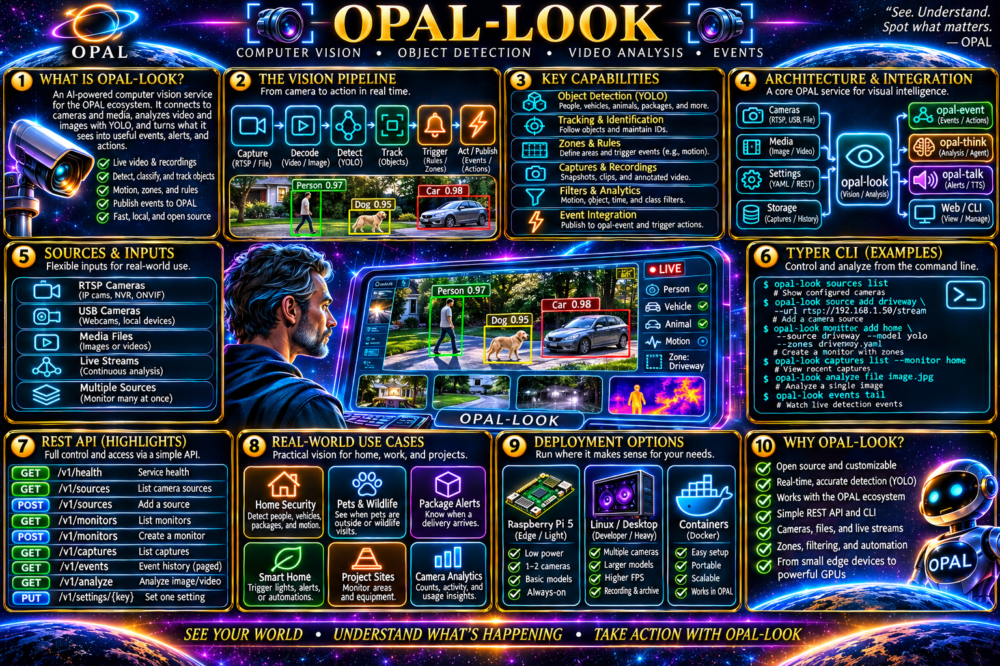

# OPAL Look YOLO

OPAL's goal is computing and intelligence that can perceive, respond, and
help through natural interaction. **OPAL Look YOLO** is the suite's
standalone object-detection adapter: it wraps Ultralytics YOLO behind a
small REST contract, so any program can list local model weights, load
them onto available hardware, and get back detections — bounding boxes,
class names, and confidences — for JPEG and PNG images.

Use it when software needs to answer *"what's in this picture?"* without
embedding an ML stack: call the CLI for one-off predictions, run it as a
microservice other processes can call over HTTP, or plug it into
[OPAL Look](https://github.com/PatMartin/opal-look) for detection on live
camera streams. It is fully self-contained — no other OPAL module is
required.

> **Work in progress.** I'm actively building OPAL and will break things
> often. Expect breaking changes to commands, configuration, and
> interfaces. No stability or backward-compatibility guarantees are made.

Material limitations today: model weights are **not bundled** — discovery
is read-only over local directories you configure. Inference is
synchronous and bounded (past the concurrency limit you get `429`), and
runs on CPU unless a Torch-visible GPU is present.

**Contents:** [What you can do](#what-you-can-do) · [Quickstart](#quickstart) · [Core concepts](#core-concepts) · [Common tasks](#common-tasks) · [Configuration](#configuration) · [Troubleshooting](#troubleshooting) · [Documentation](#further-documentation) · [Contributing](#contributing-and-license)

---

## What you can do

- **Detect objects in any image** — point the CLI at a JPEG/PNG and get
  labeled bounding boxes back. No server process required.
  → [Detect objects in an image](#detect-objects-in-an-image)
- **Run a shared detection microservice** — `serve` exposes the same REST
  API plus a browser console, so tools in any language can predict over
  HTTP. → [Run it as a service](#run-it-as-a-service)
- **Give OPAL Look real object detection** — register this service as
  Look's YOLO engine for detections on live camera streams.
  → [Power OPAL Look streams](#power-opal-look-streams)

## Quickstart

**Verified** on Windows (Python 3.13) with `yolo26n.pt` weights — install,
model listing, and a real prediction were all exercised in both embedded
and service modes. The same steps apply on Linux/macOS.

Prerequisites: Python 3.11–3.13. Installing pulls in Ultralytics and
PyTorch — expect a large download the first time.

```bash
git clone https://github.com/PatMartin/opal-look-yolo.git
cd opal-look-yolo
python -m venv .venv && .venv\Scripts\activate   # Linux/macOS: source .venv/bin/activate
python -m pip install -e .
```

Put a supported weights file (`.pt`, `.onnx`, `.engine`, `.torchscript`,
`.tflite`) into `models/` — for example `yolo26n.pt`. The filename without
its extension becomes the model ID.

```bash
yolo-look models list                          # shows yolo26n, ...
yolo-look predict photo.jpg --model-id yolo26n
```

Expected result (real output, truncated — `photo.jpg` is any JPEG/PNG you
supply):

```json
{
  "detections": [
    {
      "box": [176.3, 73.9, 255.5, 289.9],
      "class_id": 0,
      "class_name": "person",
      "confidence": 0.876
    }
  ],
  "engine": "yolo",
  "model_id": "yolo26n"
}
```

The CLI runs the whole service in-process (embedded ASGI), so there is
nothing to stop or clean up. For a persistent service, see
[Run it as a service](#run-it-as-a-service).

## Core concepts

- **Model IDs are filenames.** `yolo26n.pt` inside a configured model
  directory is addressable as `yolo26n`. Discovery is recursive and
  read-only — "installing" a model means copying a file into a configured
  directory.
- **Embedded vs. remote CLI.** With no `--url` / `OPAL_YOLO_URL`, every
  command hosts the FastAPI app in-process for that invocation. Set a URL
  to talk to a `yolo-look serve` instance instead.
- **Detect vs. task variants.** Plain weights like `yolo26n.pt` return
  bounding boxes. Filename suffixes select other tasks — `-cls` classify,
  `-seg` segment, `-pose` keypoints, `-obb` oriented boxes — and only
  detect models populate `detections`.
- **Engine options pass through to Ultralytics.** `classes` filters to
  specific class IDs; `imgsz`, `iou`, `max_det`, `half` and others tune
  inference. Unknown options are rejected with `422`.
- **Sources resolve on the service side.** Local paths and `file://` URIs
  always work. HTTP(S) sources require `OPAL_YOLO_ALLOW_REMOTE_SOURCES`
  plus a host allowlist.

## Common tasks

### With this module

#### Detect objects in an image

**Outcome:** labeled bounding boxes for everything a detect model finds.

**Requirements:** a detect weights file in a configured model directory
(Quickstart).

```bash
yolo-look predict photo.jpg --model-id yolo26n
```

**Result:** a `detections` array — each entry has `class_id`,
`class_name`, `confidence`, and `box` as `[x1, y1, x2, y2]` pixels.

#### Detect only specific things

**Outcome:** restrict output to the classes you care about and raise the
quality bar.

```bash
# persons only (COCO class 0)
yolo-look predict photo.jpg --model-id yolo26n \
  --confidence 0.5 --engine-options '{"classes": [0]}'

# cars and trucks
yolo-look predict photo.jpg --model-id yolo26n \
  --engine-options '{"classes": [2, 6]}'
```

**Result:** `detections` contains only the requested classes at or above
`--confidence`. Add `--include-native` to see the model's class-ID → name
table (`native.names`) when you need to look up an ID.

#### Run it as a service

**Outcome:** a persistent REST API plus browser console that other
processes — and the CLI in remote mode — can share.

```bash
yolo-look serve            # listens on OPAL_YOLO_HOST:OPAL_YOLO_PORT
                           # default http://127.0.0.1:8086
```

In a second terminal:

```bash
yolo-look --url http://127.0.0.1:8086 info health
# {"engine_available": true, "status": "ok"}
```

Open `http://127.0.0.1:8086/app/` for the operations console. Stop the
service with `Ctrl+C`. One useful service-side difference from embedded
mode: `models load` keeps weights warm between requests.

#### Predict on pipeline frames

**Outcome:** the same detections for images already in memory in a
caller — bytes are uploaded with the request instead of read from disk,
and caller frame metadata is echoed back for correlation.

```bash
yolo-look predict-frame --image frame.png --model-id yolo26n \
  --frame '{"stream_id":"cam-1","frame_id":"f-42","sequence":42,
            "captured_at":"2026-11-17T12:00:00Z",
            "image":{"width":640,"height":480}}'
```

**Result:** detections plus the echoed `frame` envelope.

### With the OPAL suite

#### Power OPAL Look streams

**Outcome:** real detections — and detection events — on Look's live
camera streams, replacing its deterministic test engine.

**Requires:** [opal-look](https://github.com/PatMartin/opal-look).

**This module's role:** OPAL Look ships a remote engine adapter that
proxies to this service; setting `OPAL_LOOK_ENGINE_YOLO_BASE_URL` in
Look's `.env` registers it. This service does the actual inference.

**Guide:** `docs/YOLO_INSTALL.md` in the opal-look repository covers the
adapter contract and configuration.

#### Route detections into automations

**Outcome:** camera detections trigger rules and actions — notifications,
logging, scripts.

**Requires:** opal-look plus
[opal-event](https://github.com/PatMartin/opal-event).

**This module's role:** it produces the detections; Look publishes them
as stream events, which opal-event can match against rules.

**Guide:** a dedicated integration guide is not yet available — see
opal-look's stream/SSE documentation for the event surface.

## Configuration

Settings use the `OPAL_YOLO_` prefix. Precedence, highest to lowest:
**CLI arguments → existing environment variables (including empty
strings) → `.env` entries → built-in defaults.** `./.env` is loaded (and
created from defaults when missing) at startup — see
[docs/DOTENV.md](docs/DOTENV.md) for the full policy, `--env-file`, and
`--no-env-file`.

| Setting | Default | Purpose |
|---|---|---|
| `OPAL_YOLO_HOST` | `127.0.0.1` | Bind host for `serve` |
| `OPAL_YOLO_PORT` | `8086` | Bind port for `serve` |
| `OPAL_YOLO_MODEL_DIRS` | `models` | Model directories — one path, `;`-separated (Windows) / `:`-separated (POSIX), or a JSON array |
| `OPAL_YOLO_AUTH_DISABLED` | `true` | Loopback only; `false` requires `OPAL_YOLO_AUTH_TOKEN` |
| `OPAL_YOLO_AUTH_TOKEN` | unset | Bearer token the service requires |
| `OPAL_YOLO_URL` | unset | CLI remote mode — base URL of a running service; unset means embedded |
| `OPAL_YOLO_TOKEN` | unset | Bearer token the CLI sends in remote mode |
| `OPAL_YOLO_MAX_IMAGE_BYTES` | `10485760` | Maximum image source size |
| `OPAL_YOLO_MAX_CONCURRENT_PREDICTIONS` | `2` | Inference capacity; excess gets `429` |
| `OPAL_YOLO_ALLOW_REMOTE_SOURCES` | `false` | Allow HTTP(S) image sources |
| `OPAL_YOLO_ALLOWED_REMOTE_HOSTS` | empty | Comma-separated remote-source allowlist |
| `OPAL_YOLO_REMOTE_SOURCE_TIMEOUT_SECONDS` | `5.0` | Remote-source fetch timeout |

Non-loopback binds cannot disable authentication. `.env.example` ships
every supported key with safe placeholders.

## Troubleshooting

**`{"code": "connection_failed", ...}` from a CLI command.**
`OPAL_YOLO_URL` (or `--url`) is set, pointing the CLI at a service that
isn't running. Start it with `yolo-look serve`, fix the URL, or clear the
variable (`OPAL_YOLO_URL=` or remove it from `.env`) to use embedded mode.

**`yolo-look: command not found`.**
The venv isn't activated, or the entry point predates a reinstall.
`source .venv/bin/activate` (Windows: `.venv\Scripts\activate`), or run
`python -m pip install -e .` again.

**`models list` returns `[]` or a model is `404 not_found`.**
Check `OPAL_YOLO_MODEL_DIRS` points at the directory actually holding the
weights (paths resolve relative to the service's working directory), and
that the file has a supported extension. The model ID is the filename
stem — `yolo26n.pt` → `yolo26n`, not `yolo26n.pt`.

**`detections` is empty but the image clearly has objects.**
Common causes: a `-cls`/`-seg`/`-pose` variant was used (only plain
detect weights return boxes), `--confidence` is too high, or a `classes`
filter excluded everything. Retry with `--confidence 0.2` and no
`engine-options`.

**`503 service_unavailable` on load or predict.**
The weights file failed to load in Ultralytics — check it is a supported
format for the installed `ultralytics` version, then retry
`yolo-look models show <id>` to confirm discovery sees it.

## Further documentation

- [docs/CLI.md](docs/CLI.md) — complete CLI reference and a 20-recipe
  cookbook (`yolo-look tree` prints the live command tree).
- [docs/DOTENV.md](docs/DOTENV.md) — `.env` loading, initialization,
  precedence, and embedded/subprocess behavior.
- [openapi/opal_look_yolo.yaml](openapi/opal_look_yolo.yaml) — the
  authoritative REST contract (14 operations; generated schema is
  reconciled against it in tests).
- `docs/YOLO_INSTALL.md` in
  [opal-look](https://github.com/PatMartin/opal-look) — using this
  service as Look's YOLO engine.
- `http://127.0.0.1:8086/app/` — bundled browser console when the service
  is running.

## Contributing and license

Issues and pull requests go to
[github.com/PatMartin/opal-look-yolo](https://github.com/PatMartin/opal-look-yolo).
Run `pytest` and `ruff check src tests` before submitting — both should
be clean (95 tests at last count).

Licensed under the [Apache License 2.0](LICENSE).
