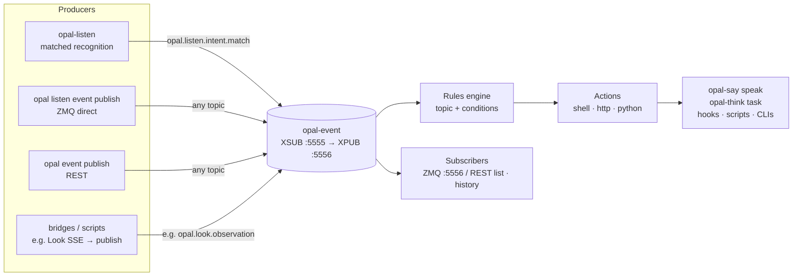

# The OPAL Cookbook

*Recipes for a local-first suite that can hear you, see your porch, think
about it, gossip over an event bus, and announce the verdict out loud.*

Every recipe below uses a **real, implemented CLI** — command shapes were
checked against the tools themselves, not just the OpenAPI contracts.
Each service also ships a deeper per-repo cookbook under `docs/`; this one
is the tour of the whole kitchen.

## Contents

- [Introduction](#introduction)
- [Setup notes for these recipes](#setup-notes-for-these-recipes)
- [CLI command tree](#cli-command-tree)
- [Event flow](#event-flow)
- [Recipes](#recipes)
  - [opal devices](#opal-devices)
  - [opal say](#opal-say)
  - [opal listen](#opal-listen)
  - [opal look](#opal-look)
  - [opal think](#opal-think)
  - [opal event](#opal-event)
  - [Combined](#combined)

## Introduction

OPAL is a set of small, local-first services for building AI tools that
can **hear, speak, see, reason, and act**. Each service is a FastAPI REST
API with a matching Typer CLI (and most ship a browser console). They work
alone and get more interesting together: a Raspberry Pi can run voice
recognition while a bigger box runs the language model, and the event bus
glues them into automations.

| Service | CLI | What it does | Default REST |
|---|---|---|---|
| [opal-listen](https://github.com/PatMartin/opal-listen) | `opal listen` | Wakeword + speech-to-intent/slot recognition | `127.0.0.1:8000` |
| [opal-say](https://github.com/PatMartin/opal-say) | `opal say` / `opal-say` | Text-to-speech (Piper, Kokoro), voices/personas | `127.0.0.1:8001` |
| [opal-look](https://github.com/PatMartin/opal-look) | `opal look` / `opal-look` | RTSP streams, snapshots, SSE detections via engines | `127.0.0.1:8002` |
| [opal-think](https://github.com/PatMartin/opal-think) | `opal think` / `opal-think` | Guarded LLM reasoning (Ollama/OpenAI), sessions, tasks | `127.0.0.1:8080` |
| [opal-event](https://github.com/PatMartin/opal-event) | `opal event` / `opal-event` | Event bus + history, rules, shell/HTTP/python actions | `127.0.0.1:8080` |
| [opal-device](https://github.com/PatMartin/opal-device) | `opal-device` | Device registry, groups, discovery, federation | `127.0.0.1:8080` |
| [opal-look-yolo](https://github.com/PatMartin/opal-look-yolo) | `yolo-look` / `opal-yolo` | Standalone Ultralytics YOLO inference adapter | `127.0.0.1:8086` |

Three services default to port **8080** — they can't share it. The recipes
assume the defaults above; adjust `--api-url`/`--url` or the `*_URL` env
vars to your deployment.

Each service repo owns its own virtualenv and CLI. Run a service's
commands inside its checkout (`uv run` or an activated `.venv`). The
`opal` umbrella command inside each checkout exposes that service's group
— e.g. `opal think …` works in the opal-think venv, `opal say …` in
opal-say's. The orchestrator checkout adds `opal service …` for starting
and stopping the managed services (look, listen, say, think).

## Setup notes for these recipes

- **Endpoints.** Point a client at a non-default service with its flag or
  env var: `OPAL_LISTEN_API_URL`, `OPAL_SAY_API_URL`, `OPAL_LOOK_URL`,
  `OPAL_THINK_API_URL`, `OPAL_EVENT_API_URL`, `OPAL_DEVICE_URL`,
  `OPAL_YOLO_URL`.
- **Tokens.** Where auth is enabled, set `OPAL_LISTENER_API_TOKEN`,
  `OPAL_THINK_API_TOKEN`, `OPAL_EVENT_API_TOKEN`, `OPAL_DEVICE_TOKEN`,
  `OPAL_YOLO_TOKEN`, or `OPAL_LOOK_TOKEN` — the CLIs send them
  automatically. Loopback development mode usually needs none.
- **Identifiers.** `cam-front`, `en-us-amy-low`, `ollama:llama3.2`,
  `tsk-123`, `pi-garage/doorcam` and similar are examples — use the IDs
  your services return.
- **Shell.** POSIX quoting throughout; every snippet is a fenced block you
  can copy straight into Git Bash, bash, or zsh. PowerShell needs inner
  JSON quotes escaped.

## CLI command tree

```text
opal
├── service                  orchestrator: managed services (look, listen, say, think)
│   └── list · show · update · start · stop · restart · status · logs
│
├── listen                   opal-listen client (REST :8000, ZMQ publish)
│   ├── wakeword             list · get · add · update · remove
│   ├── intent               list · get · add · update · remove · phrases · add-phrase · remove-phrase
│   ├── slot                 list · get · add · update · remove · values · add-value · remove-value · aliases · add-alias · remove-alias
│   ├── profile              list · get · add · update · activate · remove
│   ├── persona              list · get · add · update · remove · validate
│   ├── test                 text · audio · listen · listen-debug · regression
│   ├── pipeline             start · stop · status
│   ├── failed               list · get · add · update · remove · promote
│   ├── regression           list · get · add · update · remove
│   ├── reaction             list · get · add · update · remove · enable · disable · test · log · path
│   ├── config               validate · backup(s) · restore · download · export · import · setting
│   ├── service              doctor · devices · info · ping · live · ready · start · stop · log · perf
│   └── event                publish TOPIC MESSAGE            # ZeroMQ → bus
│
├── say                      opal-say client (REST :8001)
│   ├── generate TEXT        -o · --stream · --play · --profile · --persona · --voice · --engine · --speed · --volume · --format · --sample-rate
│   ├── engine               list · get · update · validate
│   ├── voice                list · add · get · update · remove · validate · test
│   ├── profile              list · add · get · update · remove · activate
│   ├── persona              list · add · get · update · remove · validate
│   ├── config setting       list · show · set · update · remove
│   ├── backup               list · create · download · restore · delete · export · import · validate
│   ├── service              start · stop · log
│   └── info                 version · health · live · ready · ping
│
├── look                     opal-look client (REST :8002)
│   ├── engine               list · show · discover · capabilities
│   ├── model                list · show · load · unload   [--engine]
│   ├── predict image        --engine · --model · --source · [--confidence · --device · --options · --include-native]
│   ├── hardware             list · show   [--engine]
│   ├── stream               start SOURCE · list · show · stop · watch · watch-video · snapshot · metrics
│   ├── info                 health · live · ready · version · ping
│   ├── backup               list · create · download · restore · remove · export · import · validate
│   ├── service              start · stop · log
│   ├── config               engine update · profile · setting
│   └── setting              get · delete
│
├── think                    opal-think client (REST :8080)
│   ├── ask <prompt>         [--model · --session-id · --stream]
│   ├── chat                 [--model · --session-id · --stream]
│   ├── task                 create · list · show · watch · cancel
│   ├── session              add · list · show · remove
│   ├── model                list · show
│   ├── config               persona · profile · setting
│   ├── backup               create · list · download · restore · remove · export · import · validate
│   ├── service              start · stop · log
│   ├── info                 health · live · ready · version · ping
│   └── gui
│
└── event                    opal-event client (REST :8080, ZMQ broker :5555/:5556)
    ├── publish TOPIC --data-json '{…}'
    ├── list · get · delete · clear · topics · log
    ├── rules                list · create · get · update · delete · test
    ├── actions              list · create · get · update · delete · execute
    ├── executions           list · get
    ├── history              list · show · remove · clear · topics
    ├── info                 get · ping · health · stats
    ├── settings             get · update · get-key · set-key · reset-key
    ├── config setting       list · show · set · remove · update
    ├── profiles             list · create · get · update · delete · activate
    ├── personas             list · create · get · update · delete · validate
    └── backup               export · validate · import

opal-device                  device registry client (REST :8080)
├── info · health · catalog · discover · watch
├── device                   list · add · show · update · remove · capabilities · status · test · label · tag
├── group                    list · add · show · update · remove · member
├── peer                     list · add · show · update · remove · status · sync · discover
├── profile                  list · add · show · update · remove · activate
├── setting                  list · show · set · update · remove
├── default                  list · set · remove
├── sharing                  list · add · allow · deny · remove
├── plugin                   list · show · enable · disable · test · discover
├── event                    list
├── federation               inventory · registry
├── backup                   list · create · export · download · restore · import · validate · remove
└── service                  start · stop · log

yolo-look                    YOLO adapter (REST :8086, embedded ASGI without --url)
├── serve · predict · predict frame · tree
├── info                     health
├── engines                  list · discover · show · capabilities
├── models                   list · show · load · unload
└── hardware                 list · show
```

### EVENT FLOW

Events have two roads into OPAL: the **ZeroMQ broker** inside opal-event
(producers connect to XSUB at `tcp://127.0.0.1:5555`, consumers subscribe
on XPUB at `tcp://127.0.0.1:5556`) and the **REST publish endpoint** that
`opal event publish` uses. Once an event lands, the rules engine matches
`topic` + `conditions` and fires `actions`.



| Topic | Producer | Payload highlights |
|---|---|---|
| `opal.listen.intent.match` | opal-listen (on every matched, non-deduped live recognition) | `intent_name`, `intent_confidence`, `slot_values`, transcript |
| `opal.look.observation` | convention — publish Look detections yourself (Look emits SSE, not bus events) | `labels`, `stream_id`, detection details |
| anything you like | `opal event publish`, `opal listen event publish` | arbitrary JSON `data` |

Notes on the honest plumbing:

- **Look emits SSE, not bus events.** `opal-look stream watch <id>` streams
  `frame`/`detection`/`status`/`terminal` events over HTTP. To put
  detections on the bus, publish them (see
  [Detections onto the bus](#detections-onto-the-bus)).
- **Think never hears the bus directly** — it acts *through* registered
  Event actions (`actions execute`), which is the guarded path by design.
- **Listen also has `reaction`** — local conditions → shell commands,
  no bus required. Use reactions for same-box automations and Event rules
  for anything cross-service.

## Recipes

### opal devices

The device registry: what hardware exists, where, what it can do. Start
the service with `opal-device service start`; every command below is a
REST call against `OPAL_DEVICE_URL`.

```bash
# 1. Is it alive?
opal-device health
```

```bash
# 2. Service identity and version.
opal-device info
```

```bash
# 3. What device types/capabilities does the catalog know?
opal-device catalog
```

```bash
# 4. Inventory: every registered device.
opal-device device list
```

```bash
# 5. Probe this host's hardware without writing anything.
opal-device discover --dry-run
```

```bash
# 6. Real scan, including network plugins.
opal-device discover --network
```

```bash
# 7. Register a camera by hand (qualified name becomes <host>/<name>).
opal-device device add '{"name":"doorcam","host_id":"pi-garage","host_name":"Garage Pi","type":"camera","backend":"rtsp","access":"network","resource_uri":"rtsp://192.168.1.50:554/stream1"}'
```

```bash
# 8. Look at one device — by UUID or qualified name.
opal-device device show pi-garage/doorcam
```

```bash
# 9. What can it actually do?
opal-device device capabilities pi-garage/doorcam
```

```bash
# 10. Live status (reachability, last-seen).
opal-device device status pi-garage/doorcam
```

```bash
# 11. Exercise the device through its backend.
opal-device device test pi-garage/doorcam
```

```bash
# 12. Label it for humans.
opal-device device label set pi-garage/doorcam location porch
```

```bash
# 13. Tag it for selectors.
opal-device device tag add pi-garage/doorcam outdoor
```

```bash
# 14. Point it at a different stream URI.
opal-device device update pi-garage/doorcam '{"resource_uri":"rtsp://192.168.1.51:554/stream1"}'
```

```bash
# 15. Static group, then put the camera in it.
opal-device group add '{"name":"outdoor-cams","mode":"static"}'
opal-device group member add outdoor-cams pi-garage/doorcam
```

```bash
# 16. Static groups take explicit members; dynamic groups evaluate a
#     selector live instead (see the contract for the selector shape).
opal-device group add '{"name":"garage-cams","mode":"static","member_ids":["pi-garage/doorcam"]}'
opal-device group member list garage-cams
```

```bash
# 17. Plugins are how discovery finds things — inspect and toggle.
opal-device plugin list
opal-device plugin disable host
opal-device plugin enable host
```

```bash
# 18. Register a second site's registry and pull its inventory.
opal-device peer add '{"name":"barn","base_url":"http://192.168.2.10:8080","trusted":true}'
opal-device peer sync barn
```

```bash
# 19. Share devices with a peer — allow wins unless a deny matches.
opal-device sharing allow '{"peer_id":"barn","selector":{"type":"camera"}}'
```

```bash
# 20. Follow the audit trail live (SSE), or page stored events.
opal-device watch
opal-device event list --limit 10
```

### opal say

Text-to-speech with registered voices on real engines (Piper, Kokoro).
Start with `opal-say service start` (or `opal say service start`); use
`--play` to hear output locally — the service itself only returns audio
bytes.

```bash
# 1. Health first.
opal say info health
```

```bash
# 2. Which TTS engines are installed/enabled?
opal say engine list
```

```bash
# 3. What voices are registered?
opal say voice list
```

```bash
# 4. First words — generate a WAV file.
opal say generate "Hello from OPAL" -o hello.wav
```

```bash
# 5. Same thing, out loud on this machine.
opal say generate "Hello from OPAL" --play
```

```bash
# 6. Pick a voice.
opal say generate "This is Amy speaking" --voice en-us-amy-low -o amy.wav
```

```bash
# 7. Audition a voice without writing files.
opal say voice test kokoro-af-heart --text "The sky is clear." --play
```

```bash
# 8. Slower and louder.
opal say generate "Slow down there" --voice en-us-amy-low --speed 0.8 --volume 1.2 --play
```

```bash
# 9. Register a downloaded Piper voice model.
opal say voice add en-us-ryan-medium \
  --name "Ryan (medium)" --engine piper --ref en_US-ryan-medium --language en-US
```

```bash
# 10. Validate registration catches typos before requests do.
opal say voice validate en-us-ryan-medium
```

```bash
# 11. Streaming output for long text — bytes arrive as they're synthesized.
opal say generate "Chapter one. It was a bright cold day…" --stream -o chapter.wav
```

```bash
# 12. Save a reusable voice+speed+format preset and make it active.
opal say profile add radio --voice en-us-amy-low --speed 1.05 --format wav --active
```

```bash
# 13. Now speak by profile id (profiles get numeric ids — check list).
opal say profile list
opal say generate "You're listening to OPAL radio" --profile 1 --play
```

```bash
# 14. Personas bind a name to a voice — useful when Think speaks as someone.
opal say persona add butler --name "Butler" --voice en-us-ryan-medium
opal say generate "Your tea is ready" --persona butler --play
```

```bash
# 15. Engine options are engine-specific — tune Piper's cache.
opal say engine update piper -O cache_size=8
opal say engine get piper
```

```bash
# 16. Park an engine without deleting it.
opal say engine update kokoro --disable
opal say engine update kokoro --enable
```

```bash
# 17. Housekeeping — remove a voice you no longer need.
opal say voice remove en-us-ryan-medium
```

```bash
# 18. Runtime settings live in the service, not files.
opal say config setting list
```

```bash
# 19. Snapshot the whole configuration before experiments.
opal say backup export -o say-backup.json
```

```bash
# 20. Service logs when something sounds off.
opal say service log -n 50
```

### opal listen

Speech-to-intent on the microphone: wakewords, intents, slots, and local
reactions. `opal-listen-svc` runs the service; `test text`/`test audio`
exercise the whole pipeline with no microphone.

```bash
# 1. Health and readiness.
opal listen service ping
```

```bash
# 2. What does the recognizer know so far?
opal listen intent list
opal listen wakeword list
```

```bash
# 3. Teach it a wakeword.
opal listen wakeword add opal --threshold 0.5
```

```bash
# 4. Teach an intent with spoken phrases.
opal listen intent add light_turn_on \
  --phrase "turn on the lights" --phrase "lights on" --phrase "switch the lights on"
```

```bash
# 5. Give it a slot so "turn on the kitchen lights" knows *where*.
opal listen slot add room_name --type text --value kitchen --value porch
opal listen slot add-value room_name garage --alias "the garage"
```

```bash
# 6. Dry-run a sentence — no microphone needed.
opal listen test text "turn on the lights"
```

```bash
# 7. Test against a WAV file instead.
opal listen test audio sample.wav --expect-intent light_turn_on --verbose
```

```bash
# 8. Add the utterance to the regression suite so refactors can't break it.
opal listen regression add lights-basic "turn on the lights" --expect-intent light_turn_on
opal listen test regression --all
```

```bash
# 9. Bundle wakeword+intent+model choices into a named profile.
opal listen profile add default --wakeword opal --intent light_turn_on --activate
```

```bash
# 10. A local reaction: matched intent → shell command, no event bus.
opal listen reaction add lights \
  --cond "intent_name eq light_turn_on" \
  --cond "intent_confidence gte 0.8" \
  --run "echo lights on"
```

```bash
# 11. Try the reaction matcher without enabling the pipeline.
opal listen reaction test --text "turn on the lights" --execute
```

```bash
# 12. Review reaction history.
opal listen reaction log --limit 10
```

```bash
# 13. Temporarily park a reaction.
opal listen reaction disable lights
opal listen reaction enable lights
```

```bash
# 14. Fire a real microphone session (needs an audio device).
opal listen test listen --count 1 --duration 5
```

```bash
# 15. Run the live pipeline as a service task.
opal listen pipeline start
opal listen pipeline status
```

```bash
# 16. Failed utterances: every unrecognized transcript for triage.
opal listen failed list --limit 10
```

```bash
# 17. Promote a failure into training data for the right intent.
opal listen failed promote <fu_id> --intent light_turn_on --regression
```

```bash
# 18. Publish anything onto the OPAL event bus over ZeroMQ.
opal listen event publish opal.listen.note '{"msg":"hello bus"}'
```

```bash
# 19. Personas here bind recognitions to Say voices.
opal listen persona add assistant --name "Assistant" --voice en-us-amy-low
```

```bash
# 20. Export everything (wakewords, intents, slots, reactions) for backup.
opal listen config export --out-dir ./listen-backup
```

### opal look

Cameras in, answers out: RTSP streams, MJPEG/snapshots/SSE, and pluggable
inference engines. The bundled `synthetic` engine produces deterministic
test detections with zero ML dependencies — real detection uses
opal-look-yolo (see [Combined](#combined)).

```bash
# 1. Health — includes database and engine probes.
opal-look info health
```

```bash
# 2. Which engines are registered?
opal-look engine list
```

```bash
# 3. The synthetic engine's capability surface.
opal-look engine capabilities synthetic
```

```bash
# 4. Re-scan entry points/env adapters (e.g. after wiring the YOLO service).
opal-look engine discover
```

```bash
# 5. What models does the engine see?
opal-look model list --engine synthetic
```

```bash
# 6. Predict on a still image — fully deterministic, no ML deps.
opal-look predict image --engine synthetic --model synthetic-det --source ./photo.jpg
```

```bash
# 7. Raise the confidence bar.
opal-look predict image --engine synthetic --model synthetic-det \
  --source ./photo.jpg --confidence 0.8
```

```bash
# 8. Start watching a camera — returns a stream_id.
opal-look stream start rtsp://192.168.1.220:554/stream1
```

```bash
# 9. Name it on the way in so later commands are readable.
opal-look stream start rtsp://192.168.1.220:554/stream1 --name front
```

```bash
# 10. What's running?
opal-look stream list
```

```bash
# 11. One stream's detail — state, source (redacted), metrics.
opal-look stream show front
```

```bash
# 12. Grab a JPEG of what it sees right now.
opal-look stream snapshot front --out front.jpg
```

```bash
# 13. Save a chunk of the MJPEG feed to a file (e.g. for ffplay later).
opal-look stream watch-video front --out front.mjpeg --max-bytes 50000000
```

```bash
# 14. Follow live stream events (frame/status) over SSE — Ctrl-C to detach.
opal-look stream watch front
```

```bash
# 15. Throughput and decode stats.
opal-look stream metrics front
```

```bash
# 16. Inference mode: load a model and start a detecting stream.
opal-look model load synthetic-det --engine synthetic
opal-look stream start rtsp://192.168.1.220:554/stream1 \
  --name front-ai --engine synthetic --model synthetic-det
opal-look stream watch front-ai        # `detection` events now flow
```

```bash
# 17. Annotated snapshot — bounding boxes burned into the JPEG.
opal-look stream snapshot front-ai --annotated --out front-boxes.jpg
```

```bash
# 18. Stop streams when done.
opal-look stream stop front-ai
opal-look stream stop front
```

```bash
# 19. Tune service behavior at runtime (ETag-guarded).
opal-look config setting set sse_buffer_events 512
```

```bash
# 20. Back up stream/config state before experiments.
opal-look backup create
```

### opal think

Guarded reasoning: prompts become tasks that run through model providers
(Ollama first, OpenAI optional) and may only act on the world through
registered opal-event actions.

```bash
# 1. Health — reports honestly if no provider is reachable.
opal think info health
```

```bash
# 2. Which models are configured?
opal think model list
```

```bash
# 3. The simplest possible question — waits and prints the answer.
opal think ask "what is 2+2"
```

```bash
# 4. Pick a model explicitly.
opal think ask "explain zero-knowledge proofs in one paragraph" --model ollama:llama3.2
```

```bash
# 5. Stream the answer as it generates.
opal think ask "write a haiku about cameras" --stream
```

```bash
# 6. Conversation with memory — create a session, then chat inside it.
opal think session add --title "porch project"
#    -> ses-XXXX
opal think chat --session-id ses-XXXX "remember: the porch camera is named front"
opal think chat --session-id ses-XXXX "what is the porch camera called?"
```

```bash
# 7. Tasks are the durable unit — create detached, inspect later.
opal think task create "summarize the last 24h of porch detections" --detach
#    -> tsk-XXXX
opal think task show tsk-XXXX
```

```bash
# 8. Follow a running task live (SSE steps).
opal think task watch tsk-XXXX
```

```bash
# 9. List recent work, filter by state.
opal think task list --status running
opal think task list --status failed --limit 5
```

```bash
# 10. Give a task a deadline and step budget.
opal think task create "draft a watering schedule" --timeout 120 --max-steps 6
```

```bash
# 11. Cancel something long-running.
opal think task cancel tsk-XXXX
```

```bash
# 12. Personas bind reasoning to a Say voice — think's voice_id is an
#     opal-say voice, so a persona literally gets a voice.
opal think config persona add butler --name "Butler" --voice-id en-us-ryan-medium \
  --description "Polite, precise, slightly formal"
```

```bash
# 13. Check the persona parses before you rely on it.
opal think config persona validate butler
```

```bash
# 14. Portable settings presets — save and activate.
opal think config profile add research \
  --settings '{"providers.ollama.model":"llama3.2"}' --active
```

```bash
# 15. Read/change one runtime setting (ETag handled for you).
opal think config setting show providers.ollama.base_url
opal think config setting set providers.ollama.base_url '"http://127.0.0.1:11434"'
```

```bash
# 16. Patch several settings atomically.
opal think config setting update '{"ui.theme":"dark","tasks.default_timeout":300}'
```

```bash
# 17. Sessions are first-class — list and clean up.
opal think session list
opal think session remove ses-XXXX
```

```bash
# 18. Snapshot all configuration/state before experiments —
#     create a managed archive, then pull a copy off the service.
opal think backup create
opal think backup list
opal think backup download <filename> --out think-backup.tgz
```

```bash
# 19. Managed service lifecycle (pidfile + log under the data dir).
opal think service start
opal think service log --lines 50
opal think service stop
```

```bash
# 20. Prefer a browser? There's a bundled SPA too.
opal think gui
```

### opal event

The nervous system: a ZeroMQ bus plus a REST API for events, rules that
match them, and actions that do something about it. `opal-event-svc` runs
the service; rules are data, actions are registered executables.

```bash
# 1. Health and stats.
opal event info health
opal event info stats
```

```bash
# 2. Your first event — publish any topic with JSON data.
opal event publish demo.ping --data-json '{"msg":"hello"}'
```

```bash
# 3. See it land.
opal event list --topic demo.ping --limit 5
```

```bash
# 4. All topics the bus has seen.
opal event topics
```

```bash
# 5. Fetch one event by id.
opal event get <event_id>
```

```bash
# 6. Durable history — same events, queryable by time window.
opal event history list --from 2026-11-17T00:00:00Z --limit 20
```

```bash
# 7. A shell action: run a program, event JSON on stdin.
opal event actions create --json '{"id":"log_event","type":"shell","mode":"exec","executable":"cat","args":[],"stdin":"event_json"}'
```

```bash
# 8. An HTTP action: POST the event to a webhook (body templated).
opal event actions create --json '{"id":"ping_hook","type":"http","method":"POST","url":"http://127.0.0.1:9000/hook","body_mode":"event_json"}'
```

```bash
# 9. A Python action: call a function in an installed plugin module.
opal event actions create --json '{"id":"telemetry","type":"python","module":"opal_event.plugins.example","function":"handle_event"}'
```

```bash
# 10. A rule wiring topic → conditions → actions. Empty conditions = match all.
opal event rules create --json '{"id":"demo_rule","enabled":true,"topic":"demo.ping","conditions":[],"actions":["log_event"]}'
```

```bash
# 11. Dry-run a rule against a synthetic event before trusting it.
opal event rules test demo_rule --event-json '{"topic":"demo.ping","data":{"msg":"hi"}}'
```

```bash
# 12. Fire it for real and watch the rule engine work.
opal event publish demo.ping --data-json '{"msg":"round two"}'
opal event executions list --limit 5
```

```bash
# 13. Filter executions — what ran for one rule/action/event.
opal event executions list --rule-id demo_rule
opal event executions list --status failed
```

```bash
# 14. Inspect one execution — result, stdout, errors.
opal event executions get <execution_id>
```

```bash
# 15. Conditions narrow matches — here, only high-confidence intents.
opal event rules create --json '{"id":"confident_intents","topic":"opal.listen.intent.match","conditions":[{"path":"data.intent_confidence","operator":"gte","value":0.8}],"actions":["log_event"]}'
```

```bash
# 16. Update a rule in place (ETag auto-fetched).
opal event rules update demo_rule --json '{"enabled":false}'
opal event rules update demo_rule --json '{"enabled":true}'
```

```bash
# 17. Execute an action manually against any payload — great for testing.
opal event actions execute ping_hook --event-json '{"topic":"test","data":{"x":1}}'
```

```bash
# 18. Runtime knobs live in settings.
opal event settings get
opal event settings set-key retention_days --value '14'
```

```bash
# 19. Service log follows the bus itself.
opal event log --lines 50 --follow
```

```bash
# 20. Clean slate after experiments — deletes stored history.
opal event clear
```

### Combined

Where the suite gets interesting. Most recipes assume each service's CLI
is run inside its own checkout/venv; endpoints come from
[Setup notes](#setup-notes-for-these-recipes).

#### Plumbing — do this once

```bash
# 1. Start the managed four (look, listen, say, think) from the orchestrator.
opal service start --all
opal service status
```

```bash
# 2. Start the two unmanaged ones alongside.
opal-event-svc &          # event bus + REST :8080
yolo-look serve &         # YOLO adapter :8086
```

```bash
# 3. Health-sweep the whole suite — run each in its own venv/checkout.
opal listen service ping
opal say info health
opal-look info health
opal think info health
opal event info health
opal-device health
yolo-look info health
```

```bash
# 4. Point every CLI at its service once per shell.
export OPAL_LISTEN_API_URL=http://127.0.0.1:8000 \
       OPAL_SAY_API_URL=http://127.0.0.1:8001 \
       OPAL_LOOK_URL=http://127.0.0.1:8002 \
       OPAL_THINK_API_URL=http://127.0.0.1:8080 \
       OPAL_EVENT_API_URL=http://127.0.0.1:8080 \
       OPAL_YOLO_URL=http://127.0.0.1:8086
```

#### Voice in, voice out

```bash
# 5. Teach "describe the scene" and answer it yourself first.
opal listen intent add describe_scene --phrase "describe the scene" --phrase "what do you see"
opal listen test text "describe the scene" --verbose
```

```bash
# 6. The voice ack: a Say action an Event rule can call.
opal event actions create --json '{"id":"speak_ack","type":"shell","mode":"exec","executable":"opal","args":["say","generate","Acknowledged","--play"],"stdin":"none"}'
opal event actions execute speak_ack --event-json '{"topic":"test","data":{}}'
```

```bash
# 7. Rule: every matched intent gets an audible ack.
opal event rules create --json '{"id":"ack_intents","enabled":true,"topic":"opal.listen.intent.match","conditions":[],"actions":["speak_ack"]}'
```

```bash
# 8. Prove the wiring with a synthetic envelope — no microphone needed.
opal listen event publish opal.listen.intent.match \
  '{"intent_name":"describe_scene","intent_confidence":0.91,"slot_values":{},"matched":true}'
opal event list --topic opal.listen.intent.match --limit 3
```

```bash
# 9. Same automation without the bus — a local reaction on the listen box.
opal listen reaction add ack \
  --cond "intent_name eq describe_scene" \
  --run "opal say generate 'On it' --play"
opal listen reaction test --text "describe the scene" --execute
```

```bash
# 10. A spoken "good morning" briefing pipeline.
opal say generate "$(opal think ask 'give me a one-sentence morning briefing')" \
  --persona butler --play
```

#### Eyes on the property

```bash
# 11. Wire the real detector into Look: point its env adapter at the
#     running yolo service (in opal-look's .env).
echo 'OPAL_LOOK_ENGINE_YOLO_BASE_URL=http://127.0.0.1:8086' >> ../opal-look/.env
opal-look engine discover    # -> yolo appears
```

```bash
# 12. Pick real weights and warm them.
opal-look model list --engine yolo
opal-look model load yolo26n --engine yolo
```

```bash
# 13. A detecting camera stream with on-screen boxes.
opal-look stream start rtsp://192.168.1.220:554/stream1 \
  --name front-yolo --engine yolo --model yolo26n --annotate
```

```bash
# 14. Watch detection events scroll by.
opal-look stream watch front-yolo
```

```bash
# 15. The money shot — annotated JPEG.
opal-look stream snapshot front-yolo --annotated --out intruder.jpg
```

```bash
# 16. YOLO standalone: same model, no camera, straight from the adapter CLI.
yolo-look predict front.jpg --model-id yolo26n \
  --engine-options '{"classes":[0]}' --confidence 0.5
```

```bash
# 17. Register that camera in the device registry for bookkeeping.
opal-device device add '{"name":"frontcam","host_id":"home","host_name":"Home","type":"camera","backend":"rtsp","access":"network","resource_uri":"rtsp://192.168.1.220:554/stream1","labels":{"stream":"front-yolo"}}'
```

#### Detections onto the bus

```bash
# 18. Rule: a person on the porch gets announced.
opal event rules create --json '{"id":"greet_person","topic":"opal.look.observation","conditions":[{"path":"data.labels","operator":"contains","value":"person"}],"actions":["speak_person"]}'
opal event actions create --json '{"id":"speak_person","type":"shell","mode":"exec","executable":"opal","args":["say","generate","Person detected at the front","--play"],"stdin":"none"}'
```

```bash
# 19. Feed it — publish the observation the way a Look→bus bridge would.
opal event publish opal.look.observation \
  --data-json '{"stream_id":"front-yolo","labels":["person"],"confidence":0.87}'
```

```bash
# 20. Pipe camera detections onto the bus — turn Look's SSE stream into
#     bus events with a tiny bridge (jq optional but handy).
opal-look --json stream watch front-yolo | \
  while read -r line; do
    echo "$line" | grep -q '"person"' && \
      opal event publish opal.look.observation \
        --data-json "{\"stream_id\":\"front-yolo\",\"raw\":$(echo "$line" | head -c 400)}"
  done
```

```bash
# 21. Rule for a specific intent → camera snapshot.
opal event actions create --json '{"id":"snap_front","type":"shell","mode":"exec","executable":"opal-look","args":["stream","snapshot","front-yolo","--annotated","--out","snap.jpg"],"stdin":"none"}'
opal event rules create --json '{"id":"voice_snapshot","topic":"opal.listen.intent.match","conditions":[{"path":"data.intent_name","operator":"eq","value":"describe_scene"}],"actions":["snap_front","speak_ack"]}'
```

```bash
# 22. "Describe the scene" → snapshot → detection JSON → Think summarizes.
yolo-look predict snap.jpg --model-id yolo26n > det.json
opal think ask "Summarize these detections in one sentence: $(cat det.json)"
```

```bash
# 23. Wire the same loop on the bus: voice intent → snapshot + detect +
#     describe + spoken ack.
opal event actions create --json '{"id":"ask_think","type":"shell","mode":"exec","executable":"opal","args":["think","task","create","Summarize the detections in snap.jpg","--detach"],"stdin":"event_json"}'
opal event rules create --json '{"id":"scene_loop","topic":"opal.listen.intent.match","conditions":[{"path":"data.intent_name","operator":"eq","value":"describe_scene"}],"actions":["snap_front","ask_think","speak_ack"]}'
opal listen test text "describe the scene"
```

#### Voice assistant

```bash
# 24. "Ask the brain" — voice question → think task → spoken answer.
opal listen intent add ask_brain --phrase "ask the brain" --phrase "hey brain"
opal event actions create --json '{"id":"think_request","type":"shell","mode":"exec","executable":"opal","args":["think","task","create","--detach"],"stdin":"event_json"}'
opal event rules create --json '{"id":"voice_to_brain","topic":"opal.listen.intent.match","conditions":[{"path":"data.intent_name","operator":"eq","value":"ask_brain"}],"actions":["think_request"]}'
```

```bash
# 25. Session it so follow-ups remember context.
opal think session add --title "voice"
opal think chat --session-id <ses-id> --stream "what did I just ask?"
```

```bash
# 26. Persona swap via voice — "next voice" cycles a Say profile.
opal listen intent add next_voice --phrase "next voice"
opal event actions create --json '{"id":"swap_voice","type":"shell","mode":"exec","executable":"opal","args":["say","profile","activate","radio"],"stdin":"none"}'
opal event rules create --json '{"id":"voice_swap","topic":"opal.listen.intent.match","conditions":[{"path":"data.intent_name","operator":"eq","value":"next_voice"}],"actions":["swap_voice","speak_ack"]}'
```

```bash
# 27. Two-step arming for dangerous commands — rule pair pattern.
opal listen intent add unlock_door --phrase "unlock the front door"
opal listen intent add confirm_dangerous --phrase "yes I am sure"
opal event rules create --json '{"id":"unlock_step1","topic":"opal.listen.intent.match","conditions":[{"path":"data.intent_name","operator":"eq","value":"unlock_door"}],"actions":["ask_confirm"]}'
opal event actions create --json '{"id":"ask_confirm","type":"shell","mode":"exec","executable":"opal","args":["say","generate","Are you sure?","--play"],"stdin":"none"}'
opal event rules create --json '{"id":"unlock_step2","topic":"opal.listen.intent.match","conditions":[{"path":"data.intent_name","operator":"eq","value":"confirm_dangerous"}],"actions":["really_unlock"]}'
```

```bash
# 28. Night mode — one phrase fans out to speech + camera + lights.
opal listen intent add good_night --phrase "good night"
opal event actions create --json '{"id":"night_tts","type":"shell","mode":"exec","executable":"opal","args":["say","generate","Good night","--play"],"stdin":"none"}'
opal event actions create --json '{"id":"arm_doorcam","type":"shell","mode":"exec","executable":"opal-look","args":["stream","start","rtsp://192.168.1.220:554/stream1","--name","night-watch","--engine","yolo","--model","yolo26n"],"stdin":"none"}'
opal event rules create --json '{"id":"good_night","topic":"opal.listen.intent.match","conditions":[{"path":"data.intent_name","operator":"eq","value":"good_night"}],"actions":["night_tts","arm_doorcam"]}'
```

#### Home automation

```bash
# 29. Voice-controlled camera pair — one rule per direction.
opal listen intent add cam_on --phrase "camera on" --phrase "start the camera"
opal listen intent add cam_off --phrase "camera off" --phrase "stop the camera"
opal event actions create --json '{"id":"cam_on","type":"shell","mode":"exec","executable":"opal-look","args":["stream","start","rtsp://192.168.1.220:554/stream1","--name","voice-cam"],"stdin":"none"}'
opal event actions create --json '{"id":"cam_off","type":"shell","mode":"exec","executable":"opal-look","args":["stream","stop","voice-cam"],"stdin":"none"}'
opal event rules create --json '{"id":"cam_on_rule","topic":"opal.listen.intent.match","conditions":[{"path":"data.intent_name","operator":"eq","value":"cam_on"}],"actions":["cam_on"]}'
opal event rules create --json '{"id":"cam_off_rule","topic":"opal.listen.intent.match","conditions":[{"path":"data.intent_name","operator":"eq","value":"cam_off"}],"actions":["cam_off"]}'
```

```bash
# 30. Doorbell: bus event → Ding-Dong over TTS.
opal event actions create --json '{"id":"doorbell","type":"shell","mode":"exec","executable":"opal","args":["say","generate","Ding dong","--play"],"stdin":"none"}'
opal event rules create --json '{"id":"doorbell_rule","topic":"home.doorbell","conditions":[],"actions":["doorbell"]}'
opal event publish home.doorbell --data-json '{"button":"front"}'
```

```bash
# 31. Device-registry-aware automation — test a device when an event says so.
opal event actions create --json '{"id":"test_cam","type":"shell","mode":"exec","executable":"opal-device","args":["device","test","pi-garage/doorcam"],"stdin":"none"}'
opal event rules create --json '{"id":"hourly_cam_check","topic":"home.schedule.hourly","conditions":[],"actions":["test_cam"]}'
```

```bash
# 32. Announce only when the registry says the camera is reachable —
#     rule conditions can gate on any JSON field you publish.
opal event publish home.camera.check --data-json '{"device":"pi-garage/doorcam","reachable":true}'
opal event rules create --json '{"id":"cam_up_notice","topic":"home.camera.check","conditions":[{"path":"data.reachable","operator":"eq","value":true}],"actions":["speak_ack"]}'
```

```bash
# 33. Scheduled quiet hours — disable a rule set at 22:00 via cron +
#     the CLI (rules are data; toggling is cheap).
opal event rules update greet_person --json '{"enabled":false}'
opal event rules update greet_person --json '{"enabled":true}'
```

#### The classroom / office

```bash
# 34. Attendance: listen for names, log each match to the bus.
opal listen intent add mark_present --phrase "present" --phrase "here"
opal event rules create --json '{"id":"attendance","topic":"opal.listen.intent.match","conditions":[{"path":"data.intent_name","operator":"eq","value":"mark_present"}],"actions":["log_event"]}'
opal listen event publish opal.listen.intent.match '{"intent_name":"mark_present","intent_confidence":0.9,"slot_values":{"name":"sam"},"matched":true}'
opal event history list --topic opal.listen.intent.match
```

```bash
# 35. Quiz mode — Think generates the question, Say speaks it.
opal say generate "$(opal think ask 'ask one geography trivia question, question only')" --play
```

```bash
# 36. Meeting note-taker — spoken phrase → task that writes minutes.
opal listen intent add start_minutes --phrase "start meeting notes"
opal event actions create --json '{"id":"minutes","type":"shell","mode":"exec","executable":"opal","args":["think","task","create","Take meeting minutes for the next hour","--detach"],"stdin":"none"}'
opal event rules create --json '{"id":"minutes_rule","topic":"opal.listen.intent.match","conditions":[{"path":"data.intent_name","operator":"eq","value":"start_minutes"}],"actions":["minutes","speak_ack"]}'
```

```bash
# 37. Workshop PA — an announce intent speaks on a dedicated Say profile
#     (profiles have numeric ids; substitute yours from `profile list`).
opal say profile add pa --voice en-us-amy-low --speed 1.0 --volume 1.4
opal event actions create --json '{"id":"workshop_speak","type":"shell","mode":"exec","executable":"opal","args":["say","generate","Attention in the workshop","--profile","1","--play"],"stdin":"none"}'
opal event rules create --json '{"id":"announce","topic":"opal.listen.intent.match","conditions":[{"path":"data.intent_name","operator":"eq","value":"announce"}],"actions":["workshop_speak"]}'
```

#### Fleet operations

```bash
# 38. Two sites, one registry — federated inventory view.
opal-device peer add '{"name":"site-b","base_url":"http://10.0.0.5:8080","trusted":true}'
opal-device peer sync site-b
opal-device federation inventory
```

```bash
# 39. Share only cameras with the second site.
opal-device sharing allow '{"peer_id":"site-b","selector":{"type":"camera"}}'
opal-device sharing deny '{"peer_id":"site-b","selector":{"tags":"indoor"}}'
```

```bash
# 40. One approval flow for the whole suite: voice approves →
#     think picks it up → event action executes the change.
opal listen intent add approve_plan --phrase "approve the plan"
opal event actions create --json '{"id":"think_approval","type":"shell","mode":"exec","executable":"opal","args":["think","task","create","The user approved. Proceed with the pending plan.","--session-id","ses-ops"],"stdin":"none"}'
opal event rules create --json '{"id":"approval","topic":"opal.listen.intent.match","conditions":[{"path":"data.intent_name","operator":"eq","value":"approve_plan"}],"actions":["think_approval"]}'
```

```bash
# 41. Snapshot the whole suite's config before an upgrade.
opal-look backup export > backups/look.json
opal event backup export --output backups/event.json
opal think backup create                 # managed archive on the service
opal say backup export -o backups/say.json
opal-device backup export > backups/device.json
opal listen config export --out-dir backups/listen
```

```bash
# 42. Restart the managed four cleanly.
opal service stop --all
opal service start --all
opal service status
```

```bash
# 43. Tails for everything while you test a rule.
opal event log --follow &          # bus traffic
opal-look stream watch front-yolo  # detections
opal listen pipeline status        # mic pipeline
```

```bash
# 44. Port collision check — think, event, and device all default to
#     :8080; pick one port per service before starting them together.
opal-device --url http://127.0.0.1:8090 health
opal-event-svc --help | head -5    # then set OPAL_EVENT_PORT per service
```

#### Everything at once

```bash
# 45. The demo loop in six commands: see → think → say → hear → act.
opal-look stream start rtsp://192.168.1.220:554/stream1 --name demo --engine yolo --model yolo26n
opal-look stream snapshot demo --annotated --out demo.jpg
yolo-look predict demo.jpg --model-id yolo26n --engine-options '{"classes":[0]}'
opal think ask "One sentence: describe a photo with a person in it."
opal say generate "Demo complete" --persona butler --play
opal event publish demo.done --data-json '{"ok":true}'
```

```bash
# 46. Voice → registry → camera in one breath:
#     "camera on" → intent → rule → stream + spoken ack.
opal event rules create --json '{"id":"cam_plus_ack","topic":"opal.listen.intent.match","conditions":[{"path":"data.intent_name","operator":"eq","value":"cam_on"}],"actions":["cam_on","speak_ack"]}'
```

```bash
# 47. Full audit trail for one spoken command — follow the causation.
opal listen event publish opal.listen.intent.match \
  '{"intent_name":"good_night","intent_confidence":0.95,"slot_values":{},"matched":true}'
opal event list --topic opal.listen.intent.match --limit 1   # event
opal event executions list --limit 10                        # rules + actions
opal say service log -n 20                                   # speech served
```

```bash
# 48. Forward detections to your own service with an HTTP action —
#     the whole event envelope becomes the request body.
opal event actions create --json '{"id":"forward_detections","type":"http","method":"POST","url":"http://127.0.0.1:9000/detections","body_mode":"event_json"}'
opal event rules create --json '{"id":"detect_forward","topic":"opal.look.observation","conditions":[],"actions":["forward_detections"]}'
```

```bash
# 49. Zero-microphone rehearsal — the whole voice loop, scripted:
#     intent → bus → rule → say. Perfect for CI demos.
opal listen test text "good night" --save
opal listen event publish opal.listen.intent.match \
  '{"intent_name":"good_night","intent_confidence":0.9,"slot_values":{},"matched":true}'
opal event executions list --status completed --limit 5
```

```bash
# 50. Shut it all down politely.
opal service stop --all
opal-device service stop
opal-look stream stop demo 2>/dev/null; opal-look stream stop front-yolo 2>/dev/null
opal listen pipeline stop
```

---

*Each service repo has its own deeper cookbook — see `docs/COOKBOOK.md`
inside opal-listen, opal-say, opal-look, opal-think, and opal-event for
service-specific depth, and `docs/YOLO_INSTALL.md` in opal-look for the
vision-engine integration in full.*
